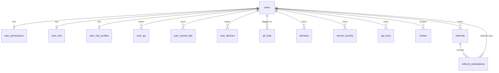

# eepy.page database schema reference

## Conventions

- **Primary Keys (`PK`)**:
  - `users.id` is `sha256(original_username)` (string).
  - **1-to-1 child tables** (`user_permissions`, `user_mfa`, `user_risk_profiles`) use `user_id` directly as their `PK` (at most 1 row per user).
  - **Composite-key child tables** (`user_ips`, `user_owned_tlds`, `user_devices`) use `(user_id, <value>)` as their `PK` (guarantees uniqueness without a separate `id` column).
  - **1-to-many child tables** (`domains`, `alt_links`, `referral_redemptions`, `recent_logouts`) use an auto-increment integer `id` as their `PK` and `user_id` (or `referral_id`) as a foreign key (`FK`).
- **Foreign Keys (`FK`)**: All child tables referencing `users.id` or `referrals.id` use `ON DELETE CASCADE`, so deleting a user automatically cleans up their child rows.
- **Encryption & Hashing**:
  - **Fernet (`ENC_KEY`)**: Reversible encryption for PII (`email`, `display_name`, MFA `secret_key` / `recovery_codes`, `api_keys.string`, `rewards.associated_email`).
  - **HMAC-SHA256 (`EMAIL_PEPPER`)**: Deterministic lookup hashes for emails (`email_hash`, `normalized_email_hash`, `rewards.email_hash`).
  - **SHA-256**: User IDs, lowercase username lookup (`users.username`), API key IDs (`sha256(key + "eepy.page")`), referral code IDs.
  - **Argon2**: Password hashes (`users.password`).
- **TTL Cleanup**: Rows in `sessions`, `codes`, `ip_activity`, `recent_logouts`, and pending-deletion `users.deleted_in` are pruned periodically by `src/database/cleanup.py`.

---

## Relationships Overview

_(Standalone tables with no FK to `users`: `sessions`, `codes`, `rewards`, `status`, `ip_activity`, `recent_logouts`.)_

---

## Core User Tables (`src/database/models/user.py`)

### 1. `users`

Primary account table.

| Column                  | Type                  | Keys / Indexes                      | Purpose                                                                                                         |
| ----------------------- | --------------------- | ----------------------------------- | --------------------------------------------------------------------------------------------------------------- |
| `id`                    | `str`                 | **PK**                              | `sha256(original_username)` stable account identifier                                                         |
| `email`                 | `str`                 |                                     | Fernet-encrypted email address                                                                                  |
| `email_hash`            | `str \| None`         | `INDEX`                             | HMAC-SHA256 of raw lowercase email (used for login lookup)                                                      |
| `normalized_email_hash` | `str \| None`         | `INDEX`                             | HMAC-SHA256 of provider-normalized email (e.g. Gmail dots/`+tag` stripped; used for duplicate signup detection) |
| `password`              | `str \| None`         |                                     | Argon2 password hash (`NULL` for OAuth-only accounts)                                                           |
| `display_name`          | `str`                 |                                     | Fernet-encrypted original-case username                                                                         |
| `username`              | `str \| None`         | `INDEX`                             | `sha256(username.lower())` for case-insensitive login                                                           |
| `lang`                  | `str`                 |                                     | Preferred UI language code (default `"en"`)                                                                     |
| `country`               | `JSON`                |                                     | Normalized 17-field `CountryInfo` snapshot from `ipinfo` at signup (missing values stored as `None`)            |
| `created`               | `BIGINT`              | `INDEX`, `INDEX(verified, created)` | Account creation Unix timestamp (seconds)                                                                       |
| `last_login`            | `BIGINT`              |                                     | Last login Unix timestamp (seconds)                                                                             |
| `feature_flags`         | `JSON`                |                                     | Per-user feature flags map (`dict[str, bool]`)                                                                  |
| `verified`              | `bool`                | `INDEX`, `INDEX(verified, created)` | Whether email address is verified                                                                               |
| `credits`               | `int`                 |                                     | Account credit balance (default `200`)                                                                          |
| `invite_code`           | `str`                 |                                     | Invite code used when signing up (if any)                                                                       |
| `banned`                | `bool`                | `INDEX`                             | Account banned / pending deletion flag                                                                          |
| `ban_reasons`           | `JSON`                |                                     | List of ban reason strings                                                                                      |
| `unbanned`              | `BIGINT \| None`      |                                     | Unix timestamp when account was reinstated                                                                      |
| `deleted_in`            | `TIMESTAMPTZ \| None` | `INDEX`                             | Scheduled permanent deletion time (52 weeks after ban)                                                          |
| `referral_code`         | `str`                 | `INDEX`                             | Plaintext referral code owned by this user (if created)                                                         |
| `referred_by`           | `str`                 | `INDEX`                             | Referral code this user signed up with                                                                          |
| `referred_count`        | `int`                 |                                     | Number of verified users who redeemed this user's referral code                                                 |
| `migration_version`     | `int`                 | `INDEX`                             | In-backend data migration version (currently `2`)                                                               |
| `extra_data`            | `JSON`                |                                     | Arbitrary extra fields (e.g. from reward code `fields` mappings)                                                |

### 2. `user_permissions`

1-to-1 table storing account limits, feature permissions, and admin panel roles.

| Column                     | Type   | Keys / Indexes              | Purpose                                              |
| -------------------------- | ------ | --------------------------- | ---------------------------------------------------- |
| `user_id`                  | `str`  | **PK**, **FK → `users.id`** | Account this row belongs to                          |
| `max_domains`              | `int`  |                             | Max root domains allowed (default `3`)               |
| `max_subdomains`           | `int`  |                             | Max subdomains allowed (default `5`)                 |
| `feature_invite`           | `bool` |                             | Can create invite codes                              |
| `admin_enabled`            | `bool` | `INDEX`                     | Master switch for admin panel access                 |
| `admin_account`            | `bool` |                             | Admin permission: ban/reinstate/manual login/status  |
| `admin_dns`                | `bool` |                             | Admin permission: edit/delete DNS & check desync     |
| `admin_manage_permissions` | `bool` |                             | Admin permission: edit user permissions & TLDs       |
| `admin_reports`            | `bool` |                             | Admin permission: view/manage abuse reports          |
| `admin_userdetails`        | `bool` |                             | Admin permission: look up user profiles & risk flags |
| `admin_wildcards`          | `bool` |                             | Admin permission: wildcard domain permissions        |

### 3. `user_mfa`

1-to-1 table storing TOTP 2FA configuration (row exists only when MFA setup is started or active).

| Column           | Type   | Keys / Indexes              | Purpose                                                                  |
| ---------------- | ------ | --------------------------- | ------------------------------------------------------------------------ |
| `user_id`        | `str`  | **PK**, **FK → `users.id`** | Account this MFA config belongs to                                       |
| `verified`       | `bool` |                             | Whether user completed TOTP verification (MFA enforced only when `True`) |
| `secret_key`     | `str`  |                             | Fernet-encrypted Base32 TOTP secret                                      |
| `recovery_codes` | `JSON` |                             | List of Fernet-encrypted backup recovery codes                           |

### 4. `user_ips`

Historical IP addresses seen on login for an account.

| Column       | Type     | Keys / Indexes              | Purpose                                       |
| ------------ | -------- | --------------------------- | --------------------------------------------- |
| `user_id`    | `str`    | **PK**, **FK → `users.id`** | Account                                       |
| `ip`         | `str`    | **PK**, `INDEX`             | IP address string                             |
| `first_seen` | `BIGINT` |                             | First login Unix timestamp from this IP       |
| `last_seen`  | `BIGINT` |                             | Most recent login Unix timestamp from this IP |

### 5. `user_owned_tlds`

TLDs the user is allowed to register domains under (e.g. `eepy.page`, `worksonmymachine.top`).

| Column    | Type  | Keys / Indexes              | Purpose                       |
| --------- | ----- | --------------------------- | ----------------------------- |
| `user_id` | `str` | **PK**, **FK → `users.id`** | Account                       |
| `tld`     | `str` | **PK**, `INDEX`             | Owned TLD without leading dot |

### 6. `user_risk_profiles`

1-to-1 anti-abuse / alt-account risk state.

| Column            | Type   | Keys / Indexes              | Purpose                                                                                                    |
| ----------------- | ------ | --------------------------- | ---------------------------------------------------------------------------------------------------------- |
| `user_id`         | `str`  | **PK**, **FK → `users.id`** | Account                                                                                                    |
| `score`           | `int`  | `INDEX`                     | Current risk score (`0-100`; flagged ≥ `40`, auto-disable ≥ `80`)                                          |
| `locked`          | `bool` |                             | When `True`, automated risk checks will not overwrite this profile (e.g. admins or admin-re-enabled users) |
| `disabled`        | `bool` | `INDEX`                     | Account soft-disabled (blocks login, refresh, sessions, API keys)                                          |
| `disable_reasons` | `JSON` |                             | List of automated or admin disable reason strings                                                          |

### 7. `user_devices`

Persistent client device tokens (`X-Device-Id`) associated with a user.

| Column       | Type     | Keys / Indexes              | Purpose                         |
| ------------ | -------- | --------------------------- | ------------------------------- |
| `user_id`    | `str`    | **PK**, **FK → `users.id`** | Account                         |
| `device_id`  | `str`    | **PK**, `INDEX`             | Sanitized client device token   |
| `first_seen` | `BIGINT` |                             | First seen Unix timestamp       |
| `last_seen`  | `BIGINT` | `INDEX`                     | Most recent seen Unix timestamp |

### 8. `alt_links`

Detected alt-account risk signals linking one user to another.

| Column            | Type             | Keys / Indexes                                                                                 | Purpose                                                           |
| ----------------- | ---------------- | ---------------------------------------------------------------------------------------------- | ----------------------------------------------------------------- |
| `id`              | `int`            | **PK** (auto-increment)                                                                        | Unique row ID                                                     |
| `user_id`         | `str`            | **FK → `users.id`**, `INDEX`, `INDEX(user_id, signal_type)`, `INDEX(user_id, related_user_id)` | Flagged account                                                   |
| `signal_type`     | `str`            | `INDEX`                                                                                        | Signal name (`shared_device`, `shared_recent_ip`, `rapid_switch`) |
| `related_user_id` | `str \| None`    | **FK → `users.id`**, `INDEX`                                                                   | The other account sharing the signal                              |
| `score`           | `int`            |                                                                                                | Score weight contributed by this flag                             |
| `reason`          | `str`            |                                                                                                | Human-readable explanation shown in admin panel                   |
| `detected_at`     | `BIGINT`         |                                                                                                | Unix timestamp when detected                                      |
| `expires_at`      | `BIGINT \| None` | `INDEX`                                                                                        | Expiration Unix timestamp (`NULL` if permanent)                   |
| `permanent`       | `bool`           |                                                                                                | Whether flag never expires                                        |

---

## Domains, Tunnels, API Keys & Invites

### 9. `domains` (`src/database/models/domain.py`)

DNS records registered by users (mirrored to PowerDNS).

| Column       | Type     | Keys / Indexes                                              | Purpose                                                        |
| ------------ | -------- | ----------------------------------------------------------- | -------------------------------------------------------------- |
| `id`         | `int`    | **PK** (auto-increment)                                     | Unique row ID                                                  |
| `user_id`    | `str`    | **FK → `users.id`**, `INDEX`, `UNIQUE(user_id, name, type)` | Owner account                                                  |
| `name`       | `str`    | `INDEX`, `INDEX(name, type)`                                | Canonical lowercase full domain name (e.g. `mysite.eepy.page`) |
| `type`       | `str`    | `INDEX`                                                     | DNS record type (`A`, `AAAA`, `CNAME`, `TXT`)                  |
| `ip`         | `JSON`   |                                                             | List of record values (`list[str]`)                            |
| `registered` | `BIGINT` |                                                             | Registration Unix timestamp                                    |

### 10. `serveo_tunnels` (`src/database/models/serveo.py`)

Serveo SSH tunnel configurations owned by users.

| Column               | Type     | Keys / Indexes               | Purpose                                               |
| -------------------- | -------- | ---------------------------- | ----------------------------------------------------- |
| `id`                 | `str`    | **PK**                       | Tunnel UUID string                                    |
| `user_id`            | `str`    | **FK → `users.id`**, `INDEX` | Owner account                                         |
| `serveo_auth_record` | `str`    |                              | TXT record name (`_serveo-authkey.<hostname>`)        |
| `ssh_fingerprint`    | `str`    |                              | SSH `SHA256:...` fingerprint stored in the TXT record |
| `subdomain`          | `str`    |                              | Requested subdomain input                             |
| `hostname`           | `str`    | `INDEX`                      | Canonical full hostname (`CNAME` → `serveo.net`)      |
| `service`            | `str`    |                              | Local target string (`localhost:<local_port>`)        |
| `local_port`         | `int`    |                              | Local port (`1-65535`)                                |
| `command`            | `str`    |                              | Generated `ssh -R ... serveo.net` command             |
| `created_at`         | `BIGINT` |                              | Creation Unix timestamp                               |
| `updated_at`         | `BIGINT` |                              | Last update Unix timestamp                            |

### 11. `api_keys` (`src/database/models/api.py`)

User API keys (`$APIV2=...`, max 1 per user).

| Column    | Type   | Keys / Indexes               | Purpose                                                                     |
| --------- | ------ | ---------------------------- | --------------------------------------------------------------------------- |
| `id`      | `str`  | **PK**                       | `sha256(raw_api_key + "eepy.page")` lookup hash                             |
| `user_id` | `str`  | **FK → `users.id`**, `INDEX` | Owner account                                                               |
| `string`  | `str`  |                              | Fernet-encrypted raw API key (so user can reveal it in settings)            |
| `perms`   | `JSON` |                              | Granted permissions (`register`, `modify`, `delete`, `list`, `userdetails`) |
| `domains` | `JSON` |                              | Allowed domains (`list[str]`, or `["*"]` for all)                           |
| `comment` | `str`  |                              | User-provided label/comment                                                 |

### 12. `invites` (`src/database/models/invite.py`)

User-created invite codes (max 3 per user).

| Column       | Type             | Keys / Indexes               | Purpose                              |
| ------------ | ---------------- | ---------------------------- | ------------------------------------ |
| `code`       | `str`            | **PK**                       | 16-char random invite code           |
| `creator_id` | `str`            | **FK → `users.id`**, `INDEX` | User who generated the invite        |
| `used`       | `bool`           | `INDEX`                      | Whether the invite has been redeemed |
| `used_by`    | `str \| None`    |                              | User ID who redeemed it              |
| `used_at`    | `BIGINT \| None` |                              | Redemption Unix timestamp            |
| `created`    | `BIGINT`         |                              | Creation Unix timestamp              |

---

## Auth, Referrals, Rewards, Status & Risk Activity

### 13. `sessions` (`src/database/models/session.py`)

Active JWT access & refresh session records.

| Column         | Type           | Keys / Indexes | Purpose                                                                                                                        |
| -------------- | -------------- | -------------- | ------------------------------------------------------------------------------------------------------------------------------ |
| `id`           | `str`          | **PK**         | JWT `jti` (unique token ID)                                                                                                    |
| `owner`        | `str`          | `INDEX`        | User ID (`users.id`)                                                                                                           |
| `owner_hash`   | `str \| None`  | `INDEX`        | Legacy `sha256(user_id + "eepy.page")` owner hash                                                                              |
| `type`         | `str`          | `INDEX`        | `"access"` or `"refresh"`                                                                                                      |
| `created`      | `BIGINT`       |                | Creation Unix timestamp                                                                                                        |
| `expires`      | `TIMESTAMPTZ`  | `INDEX`        | Token expiration time (pruned by cleanup job)                                                                                  |
| `agent`        | `str`          |                | Client `User-Agent` header                                                                                                     |
| `ip`           | `str`          |                | Client IP at session creation                                                                                                  |
| `parent`       | `str \| None`  | `INDEX`        | For `"access"` tokens, the `jti` of its paired `"refresh"` token                                                               |
| `manual_login` | `JSON \| None` |                | Admin impersonation metadata (`{"user_id": ..., "metadata": ...}`) used to restore `last_login`/`accessed_from` on termination |

### 14. `codes` (`src/database/models/session.py` `VerificationCode`)

Short-lived email verification, password recovery, and account deletion codes.

| Column          | Type          | Keys / Indexes | Purpose                                         |
| --------------- | ------------- | -------------- | ----------------------------------------------- |
| `id`            | `str`         | **PK**         | Random verification code string                 |
| `type`          | `str`         | `INDEX`        | `"verification"`, `"recovery"`, or `"deletion"` |
| `account`       | `str`         |                | Target user ID (`users.id`)                     |
| `expire`        | `BIGINT`      | `INDEX`        | Expiration Unix timestamp                       |
| `expires_after` | `TIMESTAMPTZ` | `INDEX`        | Cleanup TTL timestamp                           |

### 15. `referrals` (`src/database/models/referral.py`)

Referral codes created by users.

| Column    | Type     | Keys / Indexes               | Purpose                          |
| --------- | -------- | ---------------------------- | -------------------------------- |
| `id`      | `str`    | **PK**                       | `sha256(referral_code.lower())`  |
| `owner`   | `str`    | **FK → `users.id`**, `INDEX` | User who owns this referral code |
| `created` | `BIGINT` |                              | Creation Unix timestamp          |

### 16. `referral_redemptions` (`src/database/models/referral.py`)

Audit log of every time a referral code is redeemed upon account verification.

| Column             | Type     | Keys / Indexes                   | Purpose                               |
| ------------------ | -------- | -------------------------------- | ------------------------------------- |
| `id`               | `int`    | **PK** (auto-increment)          | Unique row ID                         |
| `referral_id`      | `str`    | **FK → `referrals.id`**, `INDEX` | Redeemed referral code                |
| `referred_user_id` | `str`    | **FK → `users.id`**, `INDEX`     | Newly verified user who used the code |
| `created_at`       | `BIGINT` |                                  | Redemption Unix timestamp             |

### 17. `rewards` (`src/database/models/reward.py`)

Redeemable reward codes (e.g. from Ko-fi purchases).

| Column             | Type          | Keys / Indexes | Purpose                                            |
| ------------------ | ------------- | -------------- | -------------------------------------------------- |
| `id`               | `str`         | **PK**         | 16-char random reward code                         |
| `created`          | `BIGINT`      |                | Creation Unix timestamp                            |
| `mappings`         | `JSON`        |                | Grants payload (`grant_tlds`, `credits`, `fields`) |
| `associated_email` | `str`         |                | Fernet-encrypted buyer email                       |
| `email_hash`       | `str`         | `INDEX`        | HMAC-SHA256 of buyer email                         |
| `used`             | `bool`        | `INDEX`        | Whether the code has been redeemed                 |
| `used_by`          | `str \| None` |                | User ID who redeemed the code                      |

### 18. `status` (`src/database/models/status.py` `StatusModel`)

Site-wide status banner messages returned by `GET /status`.

| Column    | Type    | Keys / Indexes | Purpose                                                                 |
| --------- | ------- | -------------- | ----------------------------------------------------------------------- |
| `id`      | `str`   | **PK**         | 16-char random status ID                                                |
| `time`    | `float` |                | Creation Unix timestamp                                                 |
| `message` | `str`   |                | Banner message text                                                     |
| `active`  | `bool`  | `INDEX`        | Whether this message is currently active (at most one active at a time) |

### 19. `ip_activity` (`src/database/models/risk.py` `IPActivityModel`)

Rolling 60-day IP-to-user activity index for detecting shared active IPs.

| Column          | Type          | Keys / Indexes                  | Purpose                              |
| --------------- | ------------- | ------------------------------- | ------------------------------------ |
| `id`            | `str`         | **PK**                          | Composite string `f"{ip}_{user_id}"` |
| `ip`            | `str`         | `INDEX`, `INDEX(ip, last_seen)` | Client IP address                    |
| `user_id`       | `str`         | `INDEX`                         | User ID                              |
| `last_seen`     | `BIGINT`      | `INDEX`                         | Most recent activity Unix timestamp  |
| `expires_after` | `TIMESTAMPTZ` | `INDEX`                         | TTL expiration timestamp (60 days)   |

### 20. `recent_logouts` (`src/database/models/risk.py` `RecentLogoutModel`)

Short-lived (120s) logout event log for detecting rapid account switching from the same IP or device.

| Column          | Type          | Keys / Indexes          | Purpose                                |
| --------------- | ------------- | ----------------------- | -------------------------------------- |
| `id`            | `int`         | **PK** (auto-increment) | Unique row ID                          |
| `user_id`       | `str`         | `INDEX`                 | User ID that logged out                |
| `ip`            | `str \| None` | `INDEX`                 | Client IP at logout                    |
| `device_id`     | `str \| None` | `INDEX`                 | Client device token at logout          |
| `time`          | `BIGINT`      | `INDEX`                 | Logout Unix timestamp                  |
| `expires_after` | `TIMESTAMPTZ` | `INDEX`                 | TTL expiration timestamp (120 seconds) |

<small>AI Note: This document was generated by an LLM based on the models in `src/database/models/`. This document has been reviewed, but it's still best to double-check any important information.</small>
